# tern-yazi

[中文](README.zh-CN.md)

A native Tern file browser powered by Yazi.

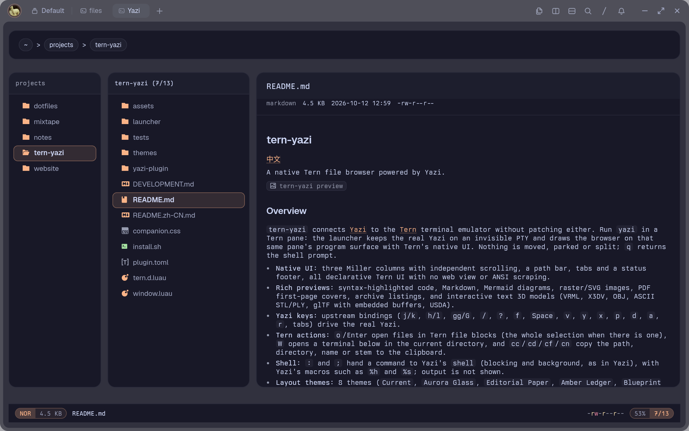

## Overview

`tern-yazi` connects [Yazi](https://github.com/sxyazi/yazi) to the [Tern](https://stencil.so/) terminal emulator without patching either. Run `yazi` in a Tern pane: the launcher keeps the real Yazi on an invisible PTY and draws the browser on that same pane's program surface with Tern's native UI. Nothing is moved, parked or split; `q` returns the shell prompt.

- **Native UI**: three Miller columns with independent scrolling, a path bar, tabs and a status footer, all declarative Tern UI with no web view or ANSI scraping.
- **Rich previews**: syntax-highlighted code, Markdown, Mermaid diagrams, raster/SVG images, PDF first-page covers, archive listings, and interactive text 3D models (VRML, X3DV, OBJ, ASCII STL/PLY, glTF with embedded buffers, USDA).
- **Yazi keys**: upstream bindings (`j/k`, `h/l`, `gg/G`, `/`, `?`, `f`, `Space`, `v`, `y`, `x`, `p`, `d`, `a`, `r`, tabs) drive the real Yazi, including recursive search (`s`/`S`), the fzf and zoxide jumps (`z`/`Z`) and the task manager (`w`). The remaining defaults are native too: the `,` sort and `m` linemode prefixes, `gh`/`gc`/`gd`/`g Space`/`gf`, `t r` tab rename, `D` permanent delete, `O` opener picker, `Tab` spot, bulk rename with a selection, and `~`/F1 for a help layer. Pending prefixes show their continuations in the dock.
- **Like Yazi**: input lines follow Yazi's vi keymap (Esc for normal mode, Esc again cancels), Ctrl+Z suspends the browser until `fg`, `q`/`Q` quit through Yazi and ask first while tasks run, `--chooser-file` picks files with Enter/`o`, and Yazi notifications appear as notices.
- **Tern actions**: `o`/Enter open files in Tern file blocks (the whole selection when there is one), `W` opens a terminal below in the current directory, and `cc`/`cd`/`cf`/`cn` copy the path, directory, name or stem to the clipboard.
- **Shell**: `:` and `;` hand a command to Yazi's `shell` with its macros such as `%h` and `%s`. As in Yazi, `:` runs in the pane in the foreground and its output stays in the scrollback; `;` runs as a background task whose log the task manager shows.
- **Layout themes**: 8 themes (`Current`, `Aurora Glass`, `Editorial Paper`, `Amber Ledger`, `Blueprint Draft`, `Brutalist Block`, `Zen Minimal`, `Swiss Grid`) chosen with `T` inside the browser. Each theme is a standalone stylesheet in `themes/<id>.css`; see [DEVELOPMENT.md](DEVELOPMENT.md#layout-themes) to customize or add one.

## Themes

Press `T` in the browser to preview the layout themes live; Enter keeps the choice. Every theme follows Tern's light and dark appearance.

| Theme | Light | Dark |
| --- | --- | --- |
| Current | 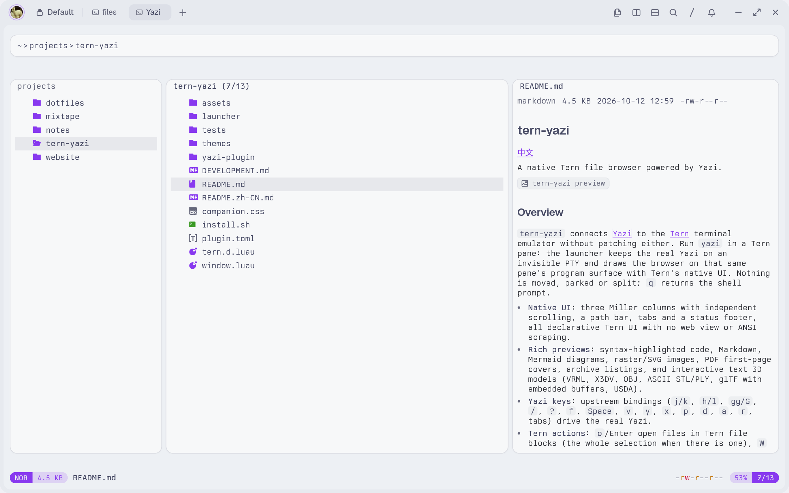 | 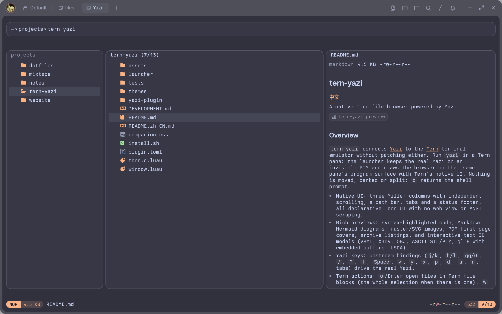 |
| Aurora Glass | 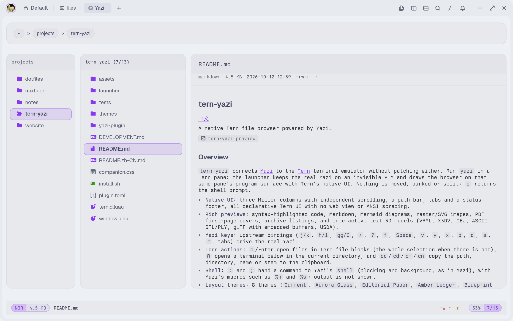 |  |
| Editorial Paper | 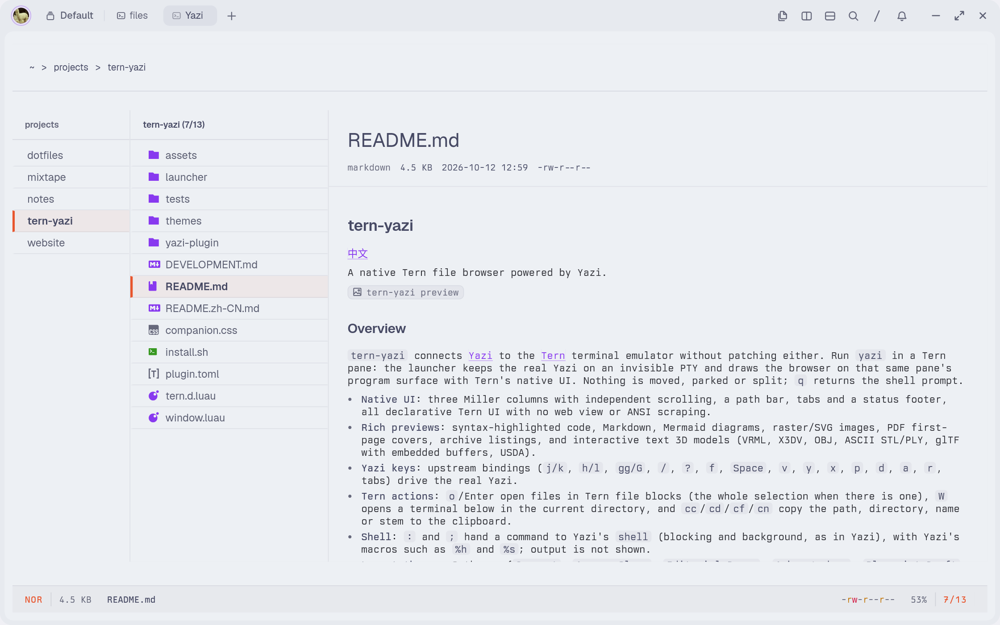 | 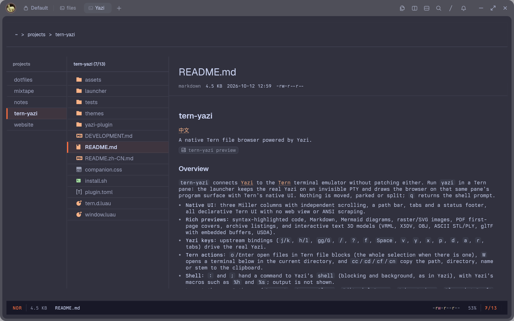 |
| Amber Ledger | 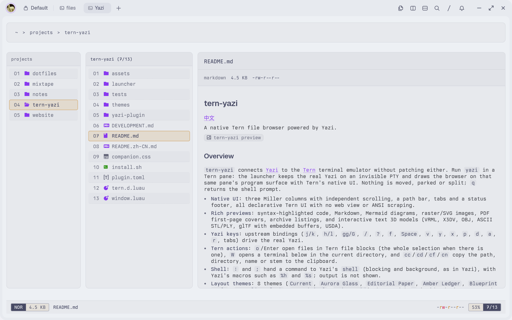 | 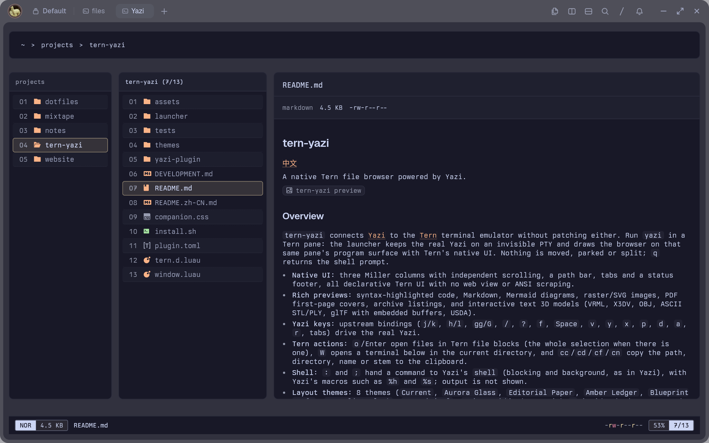 |
| Blueprint Draft | 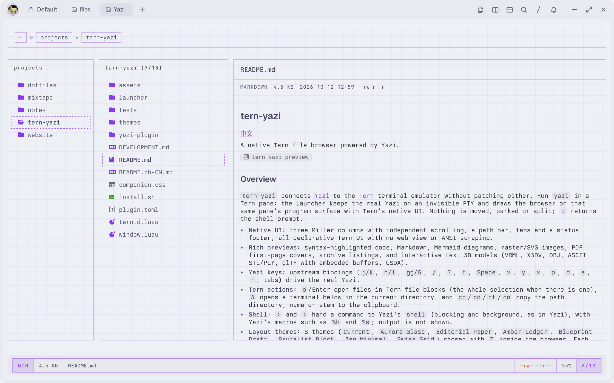 | 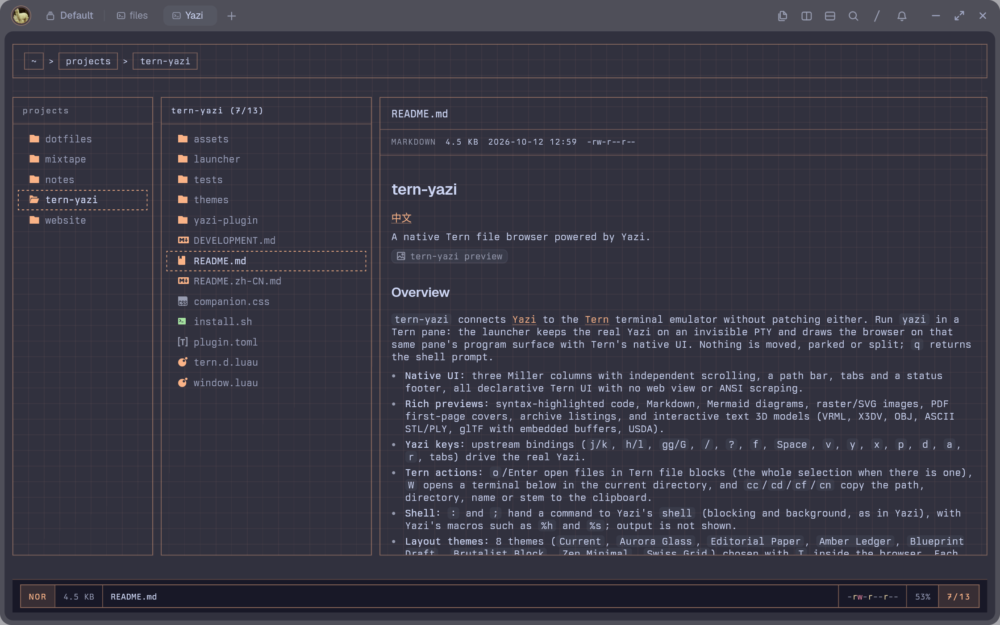 |
| Brutalist Block | 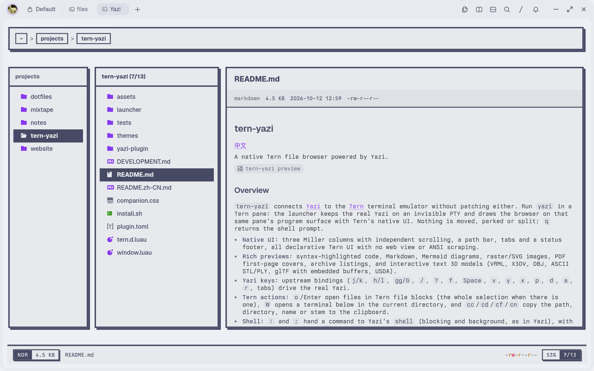 | 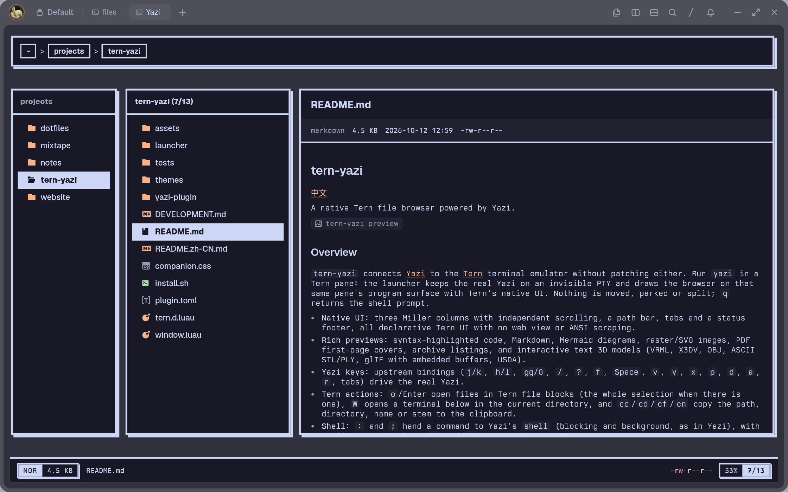 |
| Zen Minimal | 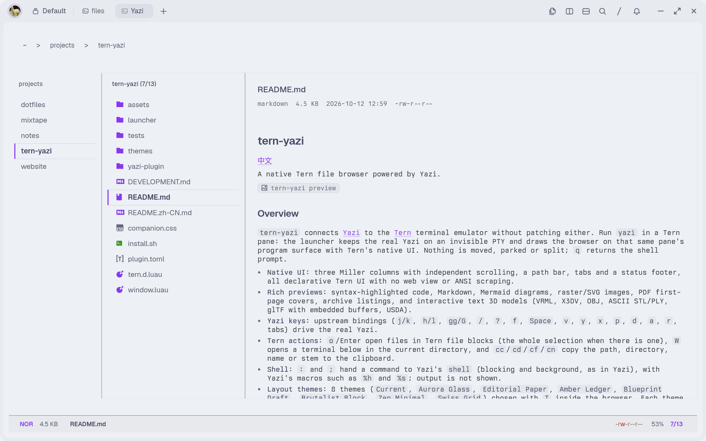 | 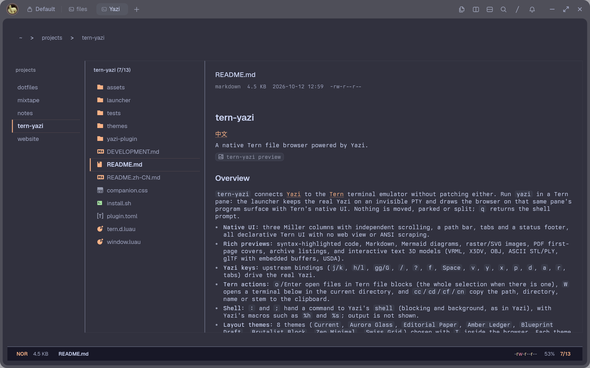 |
| Swiss Grid | 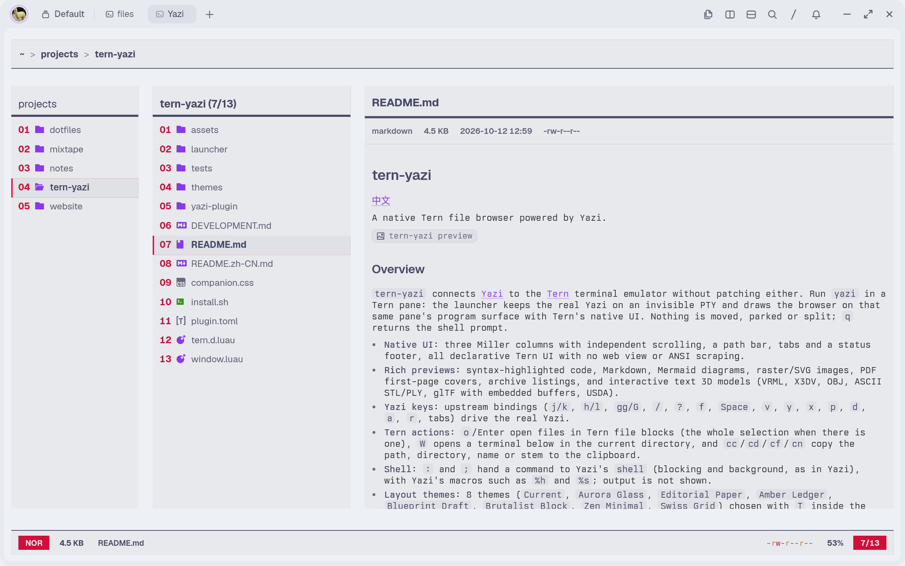 | 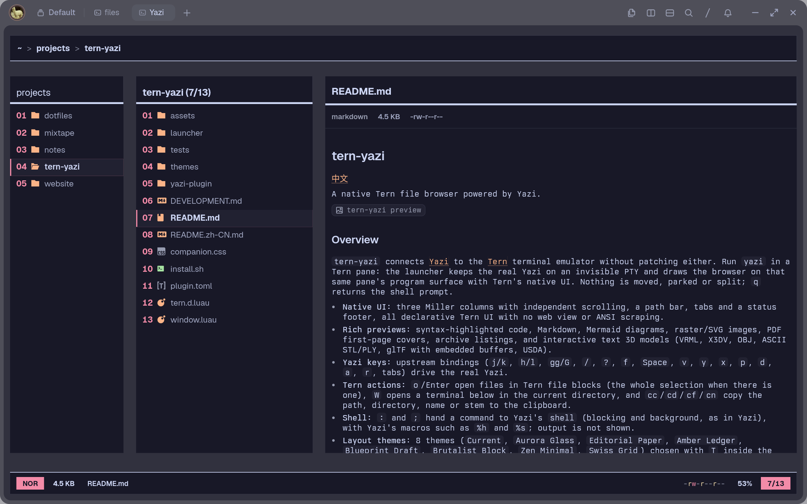 |

## Requirements

- Linux (x86_64)
- [Tern](https://stencil.so/) >= 0.7.0
- [Yazi](https://github.com/sxyazi/yazi) & `ya` >= 26.9.1
- Rust & Cargo (to compile the launcher)
- A Nerd Font installed for file glyphs

## Installation

```sh
git clone https://github.com/Liushenwuzhu-Alpaca/tern-yazi.git
cd tern-yazi
sh install.sh --real /usr/bin/yazi
export PATH="$HOME/.local/bin:$PATH"

mkdir -p "$HOME/.config/yazi/plugins"
ln -s "$PWD/yazi-plugin/tern.yazi" "$HOME/.config/yazi/plugins/tern.yazi"

# Optional: the "Yazi: Open File Browser" palette entry and Ctrl+Alt+Y
tern plugin link "$PWD"
```

Enable the Yazi plugin in your `~/.config/yazi/init.lua`:

```lua
require("tern"):setup()
```

### Usage

- **Inside Tern**: run `yazi` in any shell pane; the browser takes over that pane until `q`. The palette entry or Ctrl+Alt+Y opens a new pane to the right running the browser in the focused pane's directory.
- **Outside Tern**: the wrapper runs your original Yazi with all arguments passed through.

## License

[MIT](LICENSE)
